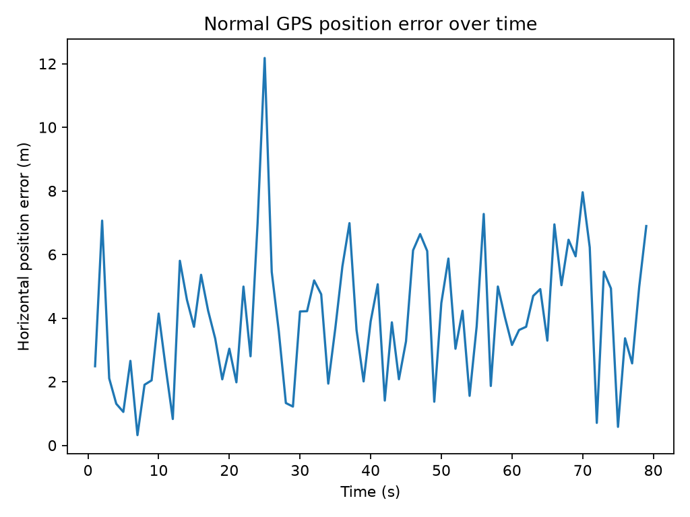
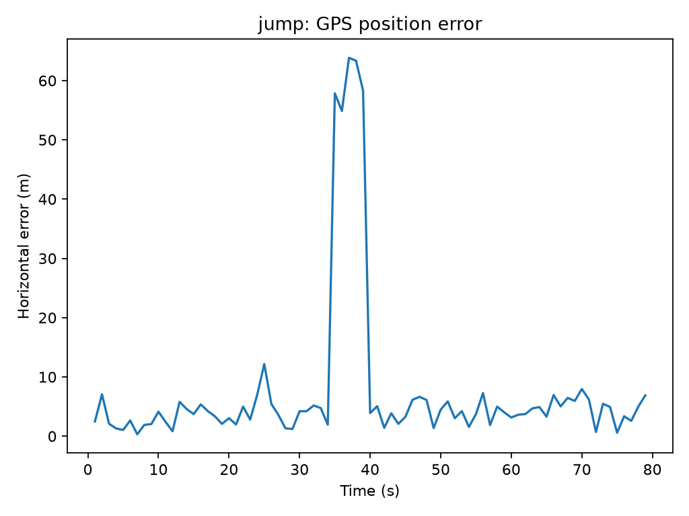
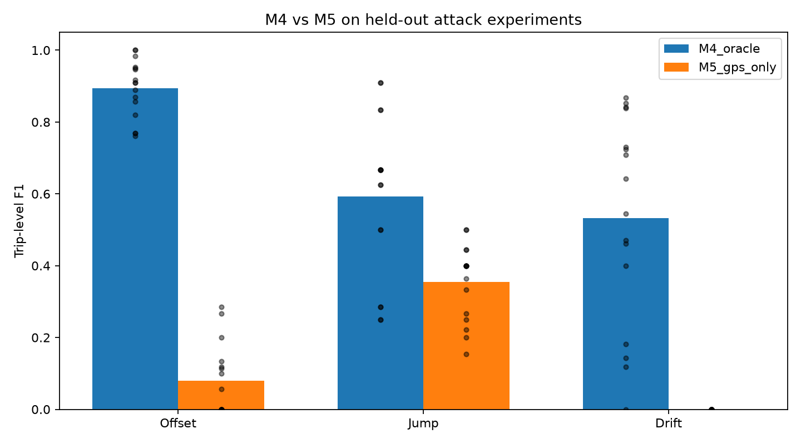
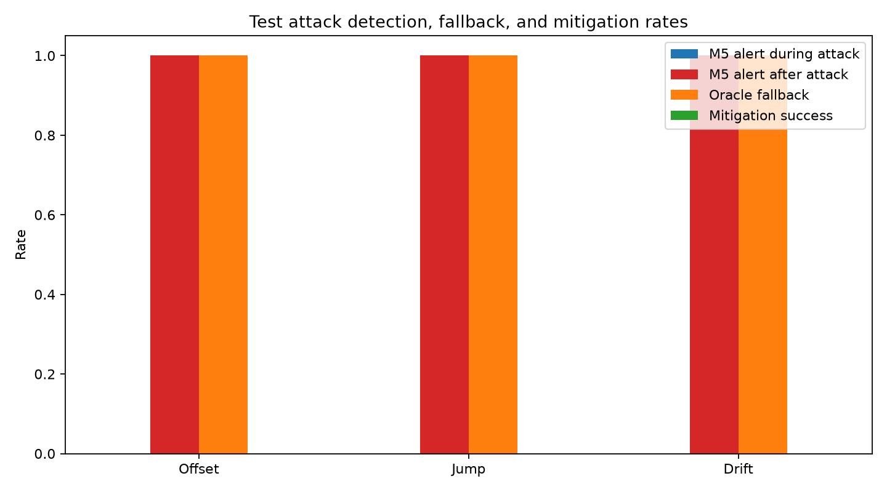
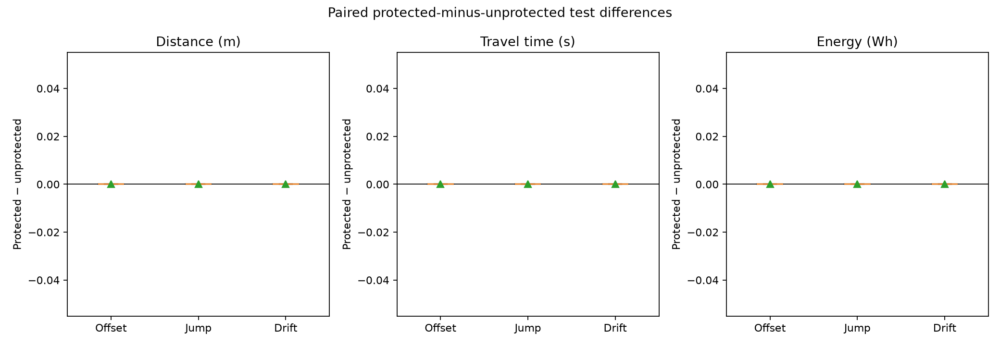
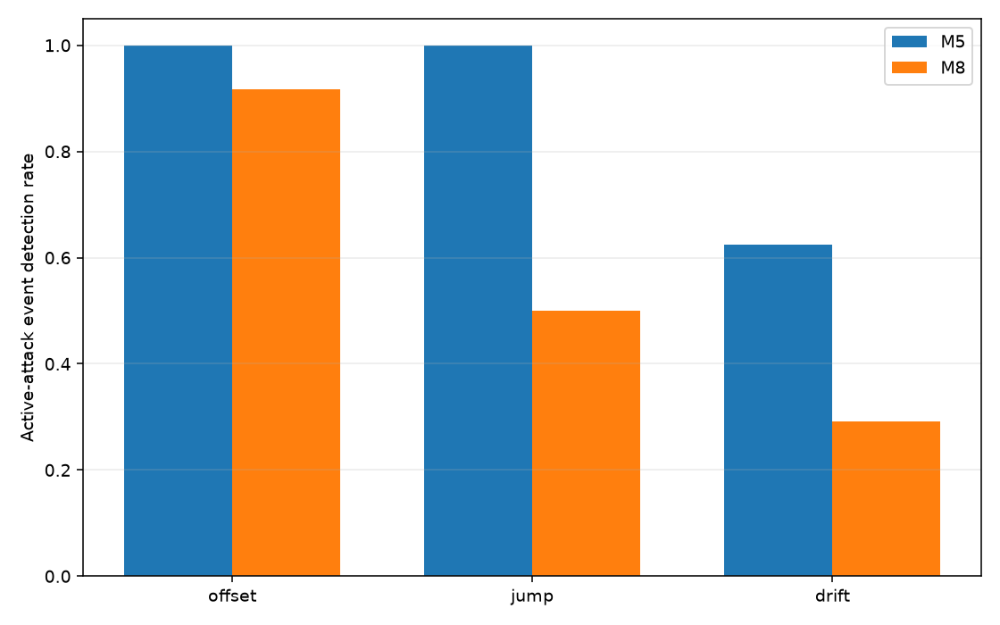
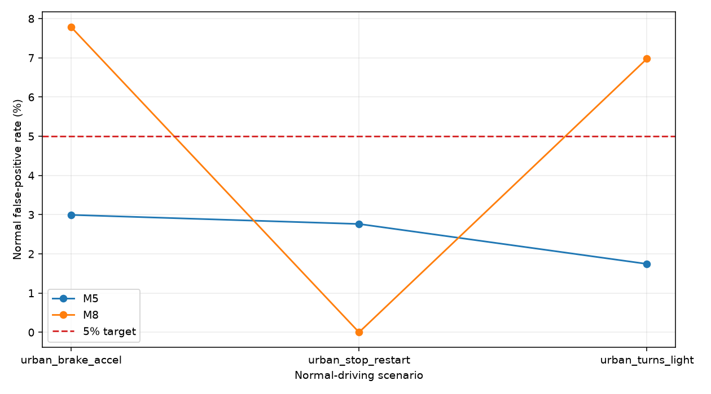

# Final Research Summary: M0–M9

## Executive summary

This project built a reproducible, simulation-only EV telemetry and GPS manipulation research system with Python, SUMO, and TraCI. It progressed from a single EV and separate ground-truth/GPS data products to four simulated GPS manipulation patterns, detector baselines, robustness studies, an online GPS-responsive routing experiment, a temporally persistent GPS-only detector, and hybrid detector error analysis.

The evidence supports several bounded conclusions. M4's residual detector detects the tested position errors well in the initial small matrix, but it uses true position and is therefore an **oracle-assisted offline benchmark**, not a GPS-only detector. M5 is a causal GPS-only motion-anomaly baseline, but its performance transfers poorly to offset and drift in the M6 held-out-seed matrix. M8's persistence and added motion features produced mixed findings and did not improve active-event detection over M5 in its final held-out matrix. M9 fusion showed the expected trade-off: OR increased event coverage but raised false alarms; AND reduced false alarms but missed more events; staged fast-suspect preserved M5 exactly while adding a distinct corroboration state. That state is not proof of spoofing.

M7 demonstrated that GPS-directed routing can change the executed path under some simulated offsets, establishing an intermediate route-change mechanism. However, the oracle-assisted fallback alerted only after each simulated attack ended. It produced no paired mitigation, route, travel-time, energy, or SOC improvement. The experiments therefore do not support an energy-saving claim or a general claim that GPS spoofing causes higher EV energy consumption.

These findings come from small, artificial SUMO scenarios and are descriptive. They do not establish real-world GNSS behavior, broad route generalization, production readiness, or statistically reliable population effects.

## 1. Research problem and objectives

The research question was whether simulation can provide a reproducible way to study GPS manipulation detection for EV trips and test whether manipulated GPS can influence route choice and measured energy use. Prior EV routing work studies energy-aware route choice and energy-consumption uncertainty [1], [2]. Broader autonomous-vehicle security and navigation-sensor surveys discuss adversarial threats and vulnerable sensing modalities [3], [4]. GPS spoofing surveys [5], secure position estimation and sensor-fusion studies [6], GPS location spoofing detection [7], and crowd-sourced corroboration [8] address relevant defenses. These publications provide context; the project results reported below come from the project evidence, not from those studies. The project specification framed the causal chain as manipulated observation → changed estimated location → changed route decision → changed executed path → changed measured energy. A coordinate error alone is not evidence of energy impact.

The work had four practical objectives:

1. Create an EV simulation and keep simulator ground truth separate from GPS observations, attack labels, predictions, and evaluation metrics.
2. Generate normal noisy GPS and offset, jump, drift, and physical alternative-route scenarios.
3. Compare an oracle residual reference with causal GPS-only motion detectors, using held-out trips/seeds where later milestone matrices provided them.
4. Test a GPS-responsive routing controller and evaluate actual path and SUMO battery outcomes under paired conditions.

The scope remained simulation-only. No physical GPS transmitter or real navigation system was involved.

## Supplementary user-selected literature

The following supplied sources are retained for traceability but are not used to substantiate the project’s GPS detector or energy-mitigation findings. Reference [9] studies class-imbalanced intrusion detection in vehicular networks, not GPS spoofing detection. Reference [10] addresses spoofed messages and trust in connected-vehicle communications, not false GPS positions. Reference [11] applies SUMO within an urban transport social-acceptance assessment. Reference [12] reviews UAV detection, security, and communications rather than ground-vehicle GPS localization. Additional background on GPS spoofing threats and countermeasures is provided by [13], [14], and vehicle-trajectory-based GPS attack anomaly detection by [15].

## 2. System architecture and data boundaries

The initial system uses SUMO road-network X/Y coordinates in meters, not geographic longitude/latitude. A separate urban transport study has used SUMO to simulate alternative vehicle technologies as input to a social-acceptance analysis [11]; its research question and outcomes differ from this project. The documented baseline uses a 1 s simulation step, fixed and recorded seeds, a Python TraCI runner, and a SUMO battery device. SUMO documents battery state separately from the emission model used to compute energy consumption [16]. The initial M0/M1 trip uses one EV on a 1,000 m one-edge route. SUMO removes the vehicle at arrival before its final state can be queried, so the inspected run has 79 active-state rows at seconds 1–79 from an 80-step run; no arrival row is synthesized.

The data flow is separated into distinct artifacts:

- **Truth telemetry:** simulator position, motion, road/route, and battery outputs.
- **GPS observations:** only timestamp, vehicle key, and noisy metric coordinates for operational detector inputs.
- **Attack labels and provenance:** sidecars and metadata used for offline scoring, not detector features.
- **Predictions and metrics:** generated first from eligible observation inputs, then joined with labels for evaluation.
- **Energy/routing telemetry:** actual SUMO route, odometer, battery, and SOC values used to check causal outcomes.

M4 is the explicit exception to an operational trust boundary: it reads ground-truth position to calculate GPS residuals, and is labeled oracle-assisted. M5, M8, and M9 GPS-only prediction paths exclude truth and labels. M7's fallback queries SUMO edge/route state after an M5 alert, so that navigation condition is also oracle-assisted.

## 3. Methodology and experimental design

### Simulation and observation model

The base telemetry is produced by SUMO/TraCI, a microscopic traffic simulation framework [17]. Normal GPS coordinates use independent, zero-mean Gaussian noise with 3 m standard deviation per axis and deterministic NumPy seeds. This is a simplified stationary coordinate-noise approximation, not a receiver-level GNSS model. Prior GPS-spoofing work includes receiver-level detection surveys [5], sensor-fusion localization defenses [6], dead-reckoning-based detection [7], and crowd-sourced external corroboration [8]; these methods use evidence that differs from the project’s simulated coordinate attacks and GPS-only motion features. M3 adds constant position offset, a finite sudden jump, capped gradual drift, and a separate physical trip on a connected alternative route. That route-deviation trip changes the vehicle's physical route; it is not a GPS-driven route-choice response to a spoofed observation.

### Detector definitions

- **M4 oracle residual rule:** Euclidean distance between GPS and simulator truth exceeds a normal-only calibrated threshold. Labels are not detector inputs.
- **M5 GPS-only temporal baseline:** previous/current GPS fixes yield estimated speed, speed change, and heading change. Related vehicle trajectory anomaly methods use motion behavior or learned expected trajectories as context [15]. Frozen upper-quantile thresholds are combined with an OR rule. The first fix is ineligible.
- **M8 enhanced GPS-only rule:** adds acceleration and rolling speed-consistency features and persistence/clearing logic. Thresholds are calibrated on normal calibration trips; validation selects operating persistence. M5 remains unchanged for paired comparison.
- **M9 fusion:** keyed M5/M8 outputs are combined as OR, AND, and staged outputs. Staged emits M5 fast-suspect immediately and separately records M8 corroboration; it does not delay or suppress M5 alerts.

### Splits, metrics, and reproducibility

Early M4/M5 results use one trip with a chronological calibration prefix and held-out suffix, so they are demonstrations rather than trip-generalization estimates. M6 uses normal-only calibration trips and held-out final-test seeds across two route definitions; both routes occur in calibration, so this is seed transfer and route variability, not leave-one-route-out validation. M8 Stage 2A separates calibration and validation trips and uses a reserved final matrix. M9 keeps its six-trip validation split separate from its six-trip final test. For M8 and M9, event recall counts an event detected during its active interval; post-attack alerts are separately reported. Observation-level denominators exclude warm-up/ineligible fixes where stated.

Repeated runs and SHA-256 manifests are used throughout the later milestones to check deterministic outputs and preservation. Time-series anomaly evaluation literature cautions that point metrics alone can misrepresent event detection, supporting the summary’s separate reporting of event recall and point-level false-positive rates [18], [19]. The canonical corrected M9 Stage 2 report is `_03`/`_04`; earlier runs remain preserved as audit history after a report aggregation correction. This summary does not combine validation and final-test estimates or treat repeated timesteps as independent trips.

## 4. Milestone development and evidence

| Milestone | Contribution and supported result | Evidence and limitation |
|---|---|---|
| **M0 — Foundation** | Established Python/TraCI, SUMO 1.28.0 environment, fixed-seed configuration, one EV and a 1,000 m road; initial run completed 80 steps. | Root `TASKS.md`, M0/M1 work log and `README.md`. One road/EV; visible GUI verification remains outstanding. |
| **M1 — EV simulation and telemetry** | Added active-step truth telemetry, battery device, charge/capacity, energy and SOC derivation. A verified seed-42 run yielded 79 queryable rows; SOC is charge/capacity. | Root `TASKS.md`, `data/raw/truth_ev_001_20261104T073118.622118Z_metadata.yaml` and config snapshot. Arrival state is unavailable after SUMO removes the vehicle. |
| **M2 — Normal GPS** | Generated separate seeded GPS observations, keyed offline errors, and plots. For the 79 matched sample, mean error/MAE 3.995736 m, RMSE 4.504651 m, p95 6.999907 m; 0 unmatched records. | Root `docs/M2_NORMAL_GPS.md`, `reports/m2/gps_normal_ev_001_20261104T073118.622118Z_metrics.json`. Independent stationary Gaussian noise is an approximation. |
| **M3 — GPS attacks** | Added offset, jump, and drift observations with separate label/provenance files; validated a connected alternative route and evaluated its separate physical trip. | Root `docs/M3_GPS_ATTACKS.md`, `external_historical_root_project/reports/m3/m3_final_verification/*_metrics.json`, separate attack/truth data and `config/m3_route_deviation.yaml`. Physical route deviation is not caused by a spoofed GPS input; no causal energy claim. |
| **M4 — Oracle detector** | Calibrated 95th percentile residual threshold 6.999907 m on first 39 normal samples; evaluated 40 normal suffix observations and 79 per attack scenario. F1: offset .9524, jump .7143, drift .9000; normal holdout FPR 2/40 = 5%. | Nested `docs/M4_GPS_DETECTION.md`; `reports/m4/m4_final_02/{summary.csv,offset_metrics.json,jump_metrics.json,drift_metrics.json,normal_metrics.json}`. Uses ground truth; single-trip test. |
| **M5 — GPS-only baseline** | Calibrated speed/change/heading thresholds on a chronological normal prefix. On 78 eligible attack fixes per scenario, F1 was offset .308 (recall .200), jump .571 (recall .800), drift .216 (recall .133); normal suffix FPR 2/40 = 5%. | Nested `docs/M5_GPS_ONLY_DETECTION.md`; `reports/m5/m5_final_02/{summary.csv,offset_metrics.json,jump_metrics.json,drift_metrics.json,normal_metrics.json}`. One trip and one intensity; weak offset/drift results. |
| **M6 — Robustness** | 52 held-out test configurations, 104 detector evaluations; 16 trips per attack group. Macro F1 M4/M5: offset .894/.080, jump .592/.355, drift .533/.000. Normal mean FPR .032 ± .017 / .019 ± .020. | Nested `docs/M6_ROBUSTNESS_EVALUATION.md`; `reports/m6/m6_full_02/` and exact repeat `m6_full_03/`. Two test seeds and two routes that both appeared in calibration; not broad or leave-one-route-out generalization. |
| **M7 — Energy-aware routing** | Built a GPS-responsive two-route controller; some 180 m offset runs executed the alternative path (2/8 per spoofed condition). Across 24 paired attack conditions, every protected/unprotected mean delta for arrival, distance, time, consumed energy, regeneration, and SOC was 0. Active M5 detection 0/8 for each attack type; all 8/8 alerts were post-attack and fallback did not mitigate. | Nested `docs/M7_GPS_AWARE_ENERGY_ROUTING.md`; complete repeated runs `reports/m7/full_matrix/m7_full_02/` and `m7_full_03/`; inspect `paired_aggregate_results.csv`, `paired_comparisons.csv`, `per_run_results.csv`, `aggregate_results.csv`, and the two PNGs in each run. SUMO-state fallback is oracle-assisted; one EV/network, two test seeds, no variable traffic. |
| **M8 — Enhanced GPS-only** | Added causal temporal features and persistence; Stage 2A selected 2-of-5 with 4.23% validation FPR. In final Stage 2B, pooled FPR M5/M8 was 2.50%/4.81%; active events offset 24/24 vs 22/24, jump 24/24 vs 12/24, drift 15/24 vs 7/24. | Nested `docs/M8_IMPROVED_GPS_DETECTION.md`; `reports/m8/stage2a/` and `reports/m8/stage2b/m8_stage2b_final_02/`. M8 did not improve event detection; two reserved seeds and profile-specific false-positive variation. |
| **M9 — Hybrid evaluation** | Compared overlap, OR/AND/staged fusion on paired M5/M8 predictions. Validation selected staged because its fast-suspect stream is M5 and met pooled 5% FPR. Final held-out staged fast equals M5; OR/AND trade-offs are documented below. | Nested `docs/M9_DETECTOR_ERROR_ANALYSIS.md`; canonical corrected `reports/m9/m9_stage2_final_03/` and `_04/`. Six trips; descriptive results only; corroboration is not attack confirmation. |

Full source paths, exact experiment IDs, metric files, and limitations are cataloged in [the evidence inventory](../reports/final_project/final_evidence_inventory.md).

### M1 simulation foundation and baseline telemetry

The seed-42 SUMO baseline uses one EV, `ev_001`, on the one-lane, one-edge `road_0` network of length 1,000 m, with a 1 s simulation step. The configured battery has 50,000 Wh capacity and starts at 25,000 Wh. The completed run took 80 simulation steps and produced 79 queryable telemetry samples at seconds 1?79; SUMO reported the trip complete, but the vehicle had been removed before its arrival-step telemetry could be queried. The historical work log records successful headless simulation and M1 schema, timing, battery-field, and reproducibility tests; those checks were not rerun for this documentation update. The project configuration specifies the time step; SUMO's official Electric-model documentation describes battery-device outputs [16], and its reference paper describes the microscopic simulator [17].

**Figure 1.** Battery charge and state of charge over the 79 queryable one-second samples of the seed-42 EV baseline. Initial battery charge was 25,000 Wh against a 50,000 Wh capacity; the arrival-step state was unavailable. This plot illustrates battery charge and SOC, not cumulative energy consumption or regeneration.

**Figure 2.** Horizontal GPS observation error across 79 active samples in the seed-2026 normal GPS baseline trip. This represents one simulated trip.

**Figure 3.** Position error during a simulated finite-jump GPS observation attack. This is an illustrative demonstration run, not the canonical final quantitative experiment; the manipulated GPS observation did not physically redirect the vehicle.

**Figure 4.** Held-out trip-level F1 by attack type for the oracle-assisted M4 residual detector and GPS-only M5 temporal detector. The evaluation matrix is small; M4 uses simulator ground truth and is not a GPS-only capability.

**Figure 5.** M7 detection and fallback outcomes across the paired test matrix. Each attack type recorded 0/8 active-attack detections and 0/8 successful mitigations, despite 8/8 post-attack alerts and fallback activations. Fallback activation is not successful mitigation.

**Figure 6.** Protected-minus-unprotected mean paired differences in distance, travel time, and energy consumption were zero across the tested M7 attack pairs. The plot does not show SOC or regenerated energy.

**Figure 7.** Held-out active-event detection rates for M5 and M8 across offset, jump, and drift scenarios. Canonical event counts (M5 vs. M8) were offset 24/24 vs. 22/24, jump 24/24 vs. 12/24, and drift 15/24 vs. 7/24; each detector had 24 events per attack class.

**Figure 8.** Profile-specific normal false-positive rates for M5 and M8 on the held-out evaluation matrix; the dashed line indicates the 5% target. Eligible-fix denominators were 167, 181, and 172 for brake/acceleration, stop/restart, and turns/light respectively (520 total). M8 exceeded the target in the brake/acceleration and turns/light profiles despite its pooled rate being below 5%.

## 5. Comparative results

### Detector progression

| Experiment and scope | Method | Normal FPR | Attack event detection | Interpretation |
|---|---|---:|---|---|
| M4 initial single-trip evaluation | Oracle residual | 5.00% (2/40) | Offset 30/30 active fixes; jump 5/5; drift 27/30 | Strong residual reference on these scenarios; unavailable without truth. |
| M5 initial single-trip evaluation | GPS-only temporal thresholds | 5.00% (2/40) | Offset 6/30; jump 4/5; drift 4/30 | Modest jump result; misses most offset and drift samples. |
| M6 held-out seed/route matrix | M4 oracle / M5 GPS-only | Mean .032 ± .017 / .019 ± .020 across four normal trips | M4 F1 .894/.592/.533 vs M5 .080/.355/.000 for offset/jump/drift (16 scenario trips per attack) | Clear gap between privileged residual and GPS-only motion features in this matrix. |
| M8 Stage 2B held-out matrix | M5 / M8 GPS-only | 2.50% / 4.81% pooled (520 normal fixes) | Offset 24/24 vs 22/24; jump 24/24 vs 12/24; drift 15/24 vs 7/24 | Added persistence did not yield an overall improvement; two M8 profiles exceeded 5% FPR. |
| M9 Stage 2 final held-out matrix | M5 / M8 / OR / AND / staged-fast / staged-corroborated | 2.98% / 7.26% / 9.12% / 1.12% / 2.98% / 5.77% (537 normal eligible fixes) | 58/72 / 60/72 / 66/72 / 50/72 / 58/72 / 52/72 | OR gains events at false-alarm cost; AND lowers false alarms at event cost; staged-fast reproduces M5 and corroboration is separate. |

M4/M5/M6 and M8/M9 figures are not interchangeable estimates: they use different trip matrices, attack grids, and denominators. The first M4/M5 rows are sample-level metrics from a 79-row single trip; later rows report trip/event-based held-out matrices. Use each row only within its stated experiment.

### M9 per-profile normal false-positive rates

| Profile | M5 | M8 | OR | AND | Staged fast suspect | Staged corroborated |
|---|---:|---:|---:|---:|---:|---:|
| Turns/light | 3.54% | 9.60% | 11.62% | 1.52% | 3.54% | 8.59% |
| Stop/restart | 3.49% | 9.88% | 12.21% | 1.16% | 3.49% | 5.23% |
| Brake/accel | 1.80% | 1.80% | 2.99% | 0.60% | 1.80% | 2.99% |

The pooled denominators are 198, 172, and 167 eligible fixes for turns/light, stop/restart, and brake/accel respectively. Pooled 537-fix false-positive counts are in the comparison table. On this final matrix M8, OR, and staged corroborated exceed 5% pooled FPR; OR is highest. The validation-selected staged-fast candidate met the 5% pooled validation limit, but final-test data were not used to tune it.

### M9 jump duration comparison

| System | 1-second jump events | Mean delay | 5-second jump events | Mean delay |
|---|---:|---:|---:|---:|
| M5 | 12/12 | 0 s | 12/12 | 0 s |
| M8 | 8/12 | 0 s | 12/12 | 0.33 s |
| OR | 12/12 | 0 s | 12/12 | 0 s |
| AND | 8/12 | 0 s | 12/12 | 0.33 s |
| Staged fast suspect | 12/12 | 0 s | 12/12 | 0 s |
| Staged corroborated | 8/12 | 0 s | 12/12 | 0.33 s |

Each duration contains 12 events, spanning two jump magnitudes, three profiles, and two seeds per profile. This is a six-trip descriptive matrix, not a general performance guarantee. In M8 Stage 2B specifically, M8 missed all one-second jumps (0/6 per magnitude) while M5 detected all six; the M9 combined result covers both magnitudes across all three profiles and has denominator 12.

## 6. Energy-aware routing investigation

Published EV eco-routing work models energy-cost-aware route selection, while EV routing research also treats uncertainty in energy consumption [1], [2]. Those studies motivate the topic but are not direct comparisons for this project’s GPS-spoofing intervention. M7 directly implemented the missing causal link: GPS observations could update a route while the EV remained on a shared approach edge, and the experiment logged actual SUMO route changes and executed edges. The protected condition retained unchanged M5 thresholds and called SUMO's route finder after an alert. Because this fallback reads SUMO route/edge state, it is an oracle-assisted research condition.

In Stage 1, an unprotected offset changed the route and the paired trip used 1,449.65 m and 224.53 Wh versus 1,378.50 m and 162.06 Wh for the normal-GPS direct trip. This is one smoke pair only. In the final 24-pair matrix, GPS-driven decisions did alter some actual routes, but M5 active-attack detection was 0/8 for offset, jump, and drift. Every alert occurred at recovery, the fallback ran after the attack interval, and all protected-minus-unprotected paired mean deltas for distance, arrival, travel time, energy, and SOC were exactly zero. Thus the Stage 1 difference cannot establish a repeatable causal energy effect or energy mitigation; the larger paired evaluation found no protected improvement.

## 7. Research contributions

- A reproducible, local SUMO/TraCI EV telemetry workflow with explicit units, seed/config snapshots, and ground-truth separation.
- Separate seeded normal GPS observations and four distinct observation/physical-route scenarios, with sidecar labels and keyed evaluation.
- A clear empirical distinction between a truth-assisted residual upper-bound-style reference and causal GPS-only temporal detectors.
- Held-out seed/route, multi-profile, event-level, and repeated-run evaluations that preserve negative and mixed findings.
- A GPS-responsive route-choice experiment that records intermediate route choices, actual executed paths, and EV battery outputs, allowing a negative mitigation result to be interpreted causally.
- A hybrid analysis that quantifies detector overlap and makes the false-alarm/coverage trade-offs among OR, AND, and staged fusion explicit.

## 8. Limitations and threats to validity

1. **Simulation realism:** SUMO maps, vehicle behavior, and traffic conditions are simplified. The base GPS noise is independent Gaussian metric noise, not a GNSS receiver or multipath model.
2. **Scope and sample size:** Many experiments use one EV and a small synthetic network. M6 has two final-test seeds and two routes; M8 and M9 final matrices each have six trips/two seeds per profile. Results are descriptive and have no useful population confidence intervals.
3. **Route generalization:** M6's two routes both appear in calibration; it is not leave-one-route-out testing.
4. **Detector observability:** For the M5/M8 feature design, a constant translation leaves successive coordinate differences unchanged, and sufficiently slow drift may remain below motion thresholds; this is a property of these GPS-only inputs, not a universal result about GNSS spoofing. Published methods often compare signal/estimated-state dynamics or use vehicle-trajectory context [14], [15]. Maneuvers can trigger motion-anomaly features. A motion anomaly is not proof of GPS spoofing.
5. **Unequal evidence scopes:** Early M4/M5, M6, M8, and M9 use different attack severities, dataset counts, exclusion rules, and denominators. Cross-row comparisons must retain their experiment labels.
6. **Oracle conditions:** M4 uses true position; M7 fallback uses SUMO route state. Neither is an operational GPS-only capability.
7. **Energy model:** Energy is generated by SUMO's configured battery/vehicle model. Published EV energy models treat consumption and regenerative braking as vehicle-model-dependent quantities [20]; these experiments do not validate a physical EV model or establish real-world range/safety implications.
8. **GUI verification:** The root tracker records that a visible desktop GUI session was unavailable; simulation and headless evidence exist, but interactive visual verification remains open.
9. **Reproducibility inputs:** Three M1/M2 inputs remain local-only and are not included in the pushed GitHub checkpoint: `data/raw/truth_ev_001_20261104T073118.622118Z.csv`, `data/raw/truth_ev_001_20261104T073118.622118Z_metadata.yaml`, and `data/processed/gps_normal_ev_001_20261104T073118.622118Z.csv`. The checkpoint is not fully self-contained for reproducing those runs.

## 9. Conclusions and future work

The project establishes a coherent simulation and evaluation pipeline, not a validated production detector. The most reliable conclusion is methodological: keep truth, observations, labels, predictions, and route/energy outcomes distinct; distinguish anomaly detection from attack attribution; and trace an energy claim through an actual route decision and executed path.

In the evidence available here, M4 is useful as an oracle reference but cannot represent GPS-only capability. M5 is a transparent baseline whose weakness on smooth offset and drift persists in the robustness study. M8's temporal persistence changes the error profile but was worse than M5 on active event detection for all attack classes in its held-out matrix. M9 fusion confirmed that combining detectors changes the operating trade-off, not that it proves spoofing; staged fast-suspect did not improve on M5. The M7 fallback was too late to mitigate the tested attacks and yielded no paired energy improvement.

Recommended future research, outside the completed M0–M9 scope, is to add more varied and independently held-out road networks and traffic/vehicle configurations; model temporally correlated receiver-level GNSS effects; evaluate independent observable sensors and map/topology constraints without simulator truth; increase independent trip/seed counts before inferential claims; and redesign routing protection around an observable localization estimate and timely response. Any energy study should continue to report route choice, executed route, arrival, distance, consumption, regeneration, and SOC for matched pairs.

## References

Bibliographic verification note: References [5], [9], and [10] are partially verified. Their details were supported by secondary records or accessible manuscripts, but were not independently confirmed against accessible publisher records. This status does not imply that the references are fabricated or invalid.

[1] N. Salahi, J. Ryu, J. Y. Kim, G. Bang, K. Hyun, and J. Y. Park, “Data-driven eco-routing for optimizing energy efficient electric vehicle driving,” *Sustainable Cities and Society*, vol. 149, Art. no. 107812, 2026, doi: [10.1016/j.scs.2026.107812](https://doi.org/10.1016/j.scs.2026.107812).

[2] A. Spinelli, D. Bezzi, O. Jabali, and F. Maggioni, “A stochastic electric vehicle routing problem under uncertain energy consumption,” *Transportation Research Part C: Emerging Technologies*, vol. 183, Art. no. 105480, Feb. 2026, doi: [10.1016/j.trc.2025.105480](https://doi.org/10.1016/j.trc.2025.105480).

[3] A. N. Devanesan, S. Hanoun, B. Karthikeyan, and A. Z. Kouzani, “Adversarial attacks in autonomous vehicles: A comprehensive review of threats and defence strategies,” *IEEE Access*, vol. 14, pp. 135233–135253, 2026, doi: [10.1109/ACCESS.2026.3727983](https://doi.org/10.1109/ACCESS.2026.3727983).

[4] A. Solanki, W. Al Amiri, M. Mahmoud, B. Swieder, S. R. Hasan, and T. N. Guo, “Survey of navigational perception sensors’ security in autonomous vehicles,” *IEEE Access*, vol. 13, pp. 104937–104965, 2025, doi: [10.1109/ACCESS.2025.3578891](https://doi.org/10.1109/ACCESS.2025.3578891).

[5] S. Jeyaseelan, P. G. S. Velmurugan, and S. Rajaram, “A comprehensive survey of GPS spoofing attacks and detection mechanisms in autonomous vehicles,” in *Proc. 2025 IEEE 17th Int. Conf. Computational Intelligence and Communication Networks (CICN)*, Goa, India, Dec. 2025, pp. 702–707, doi: [10.1109/CICN67655.2025.11367991](https://doi.org/10.1109/CICN67655.2025.11367991).

[6] Q. Chen, G. Li, P. Liu, and Z. Wang, “Anomaly detection and secure position estimation against GPS spoofing attack: A security-critical study of localization in autonomous driving,” *IEEE Transactions on Vehicular Technology*, vol. 74, no. 1, pp. 87–99, Jan. 2025, doi: [10.1109/TVT.2024.3454416](https://doi.org/10.1109/TVT.2024.3454416).

[7] M. Arsalan, M. A. Ayaz, I. A. Khan, F. Ullah, M. Kamal, F. Khan, and K. Alshammari, “A novel GPS location spoofing attack detection mechanism for autonomous vehicles,” *Wireless Personal Communications*, vol. 146, no. 6, pp. 3695–3715, 2026, doi: [10.1007/s11277-026-12095-0](https://doi.org/10.1007/s11277-026-12095-0).

[8] G. Oligeri, S. Sciancalepore, O. A. Ibrahim, and R. Di Pietro, “GPS spoofing detection via crowd-sourced information for connected vehicles,” *Computer Networks*, vol. 216, Art. no. 109230, 2022, doi: [10.1016/j.comnet.2022.109230](https://doi.org/10.1016/j.comnet.2022.109230).

[9] P. Dubey and D. Agrawal, “Comparative analysis of hybrid machine learning and deep learning models for intrusion detection in vehicular networks under severe class imbalance,” in *Proc. 4th Int. Conf. Inventive Computing and Informatics (ICICI)*, Bangalore, India, 2026, pp. 760–767, doi: [10.1109/ICICI68773.2026.11581012](https://doi.org/10.1109/ICICI68773.2026.11581012).

[10] S. O. Ajakwe and D.-S. Kim, “EQAI: Explainable quantum-empowered antispoofing intelligence for trustworthy connected autonomous vehicles communication,” *IEEE Internet of Things Journal*, vol. 13, no. 6, pp. 10213–10232, 2026, doi: [10.1109/JIOT.2025.3638378](https://doi.org/10.1109/JIOT.2025.3638378).

[11] N. España, J. Murillo-Hoyos, and E. Caicedo, “Social acceptance assessment of alternative urban sustainable transport technologies in intermediate cities using AHP and SUMO,” *World Development Sustainability*, vol. 6, Art. no. 100229, 2025, doi: [10.1016/j.wds.2025.100229](https://doi.org/10.1016/j.wds.2025.100229).

[12] G. E. M. Abro, S. A. B. M. Zulkifli, R. J. Masood, V. S. Asirvadam, and A. Laouiti, “Comprehensive review of UAV detection, security, and communication advancements to prevent threats,” *Drones*, vol. 6, no. 10, Art. no. 284, 2022, doi: [10.3390/drones6100284](https://doi.org/10.3390/drones6100284).

[13] T. E. Humphreys, B. M. Ledvina, M. L. Psiaki, B. W. O’Hanlon, and P. M. Kintner, “Assessing the spoofing threat: Development of a portable GPS civilian spoofer,” in *Proc. 21st Int. Tech. Meeting Satellite Division of the Institute of Navigation (ION GNSS 2008)*, Savannah, GA, USA, Sep. 2008, pp. 2314–2325. [Online]. Available: https://www.ion.org/publications/abstract.cfm?articleID=8132.

[14] C. Günther, “A survey of spoofing and counter-measures,” *NAVIGATION*, vol. 61, no. 3, pp. 159–177, 2014, doi: [10.1002/navi.65](https://doi.org/10.1002/navi.65).

[15] Z. Yang, J. Ying, J. Shen, Y. Feng, Q. A. Chen, Z. M. Mao, and H. X. Liu, “Anomaly detection against GPS spoofing attacks on connected and autonomous vehicles using learning from demonstration,” *IEEE Transactions on Intelligent Transportation Systems*, vol. 24, no. 9, pp. 9462–9475, 2023, doi: [10.1109/TITS.2023.3269029](https://doi.org/10.1109/TITS.2023.3269029).

[16] German Aerospace Center (DLR), “Electric,” *Eclipse SUMO Documentation*. [Online]. Available: https://sumo.dlr.de/docs/Models/Electric.html. Accessed: Nov. 12, 2026.

[17] P. Alvarez Lopez, M. Behrisch, L. Bieker-Walz, J. Erdmann, Y.-P. Flötteröd, R. Hilbrich, L. Lücken, J. Rummel, P. Wagner, and E. Wießner, “Microscopic traffic simulation using SUMO,” in *Proc. 21st IEEE Int. Conf. Intelligent Transportation Systems (ITSC)*, 2018, pp. 2575–2582, doi: [10.1109/ITSC.2018.8569938](https://doi.org/10.1109/ITSC.2018.8569938).

[18] N. Tatbul, T. J. Lee, S. Zdonik, M. Alam, and J. Gottschlich, “Precision and recall for time series,” in *Advances in Neural Information Processing Systems*, vol. 31, 2018. [Online]. Available: https://papers.nips.cc/paper_files/paper/2018/hash/8f468c873a32bb0619eaeb2050ba45d1-Abstract.html.

[19] A. Garg, W. Zhang, J. Samaran, R. Savitha, and C.-S. Foo, “An evaluation of anomaly detection and diagnosis in multivariate time series,” *IEEE Transactions on Neural Networks and Learning Systems*, vol. 33, no. 6, pp. 2508–2517, 2022, doi: [10.1109/TNNLS.2021.3105827](https://doi.org/10.1109/TNNLS.2021.3105827).

[20] C. Fiori, K. Ahn, and H. A. Rakha, “Power-based electric vehicle energy consumption model: Model development and validation,” *Applied Energy*, vol. 168, pp. 257–268, 2016, doi: [10.1016/j.apenergy.2016.01.097](https://doi.org/10.1016/j.apenergy.2016.01.097).

## Project evidence references

- Root setup and specification: `README.md`, `docs/PROJECT_SPEC.md`, `docs/IMPLEMENTATION_PLAN.md`, `TASKS.md`.
- Root early methods: `docs/M2_NORMAL_GPS.md`, `docs/M3_GPS_ATTACKS.md`.
- Nested later methods: `docs/M4_GPS_DETECTION.md` through `M9_DETECTOR_ERROR_ANALYSIS.md`.
- Exact source report locations and experiment IDs: [final evidence inventory](../reports/final_project/final_evidence_inventory.md).
