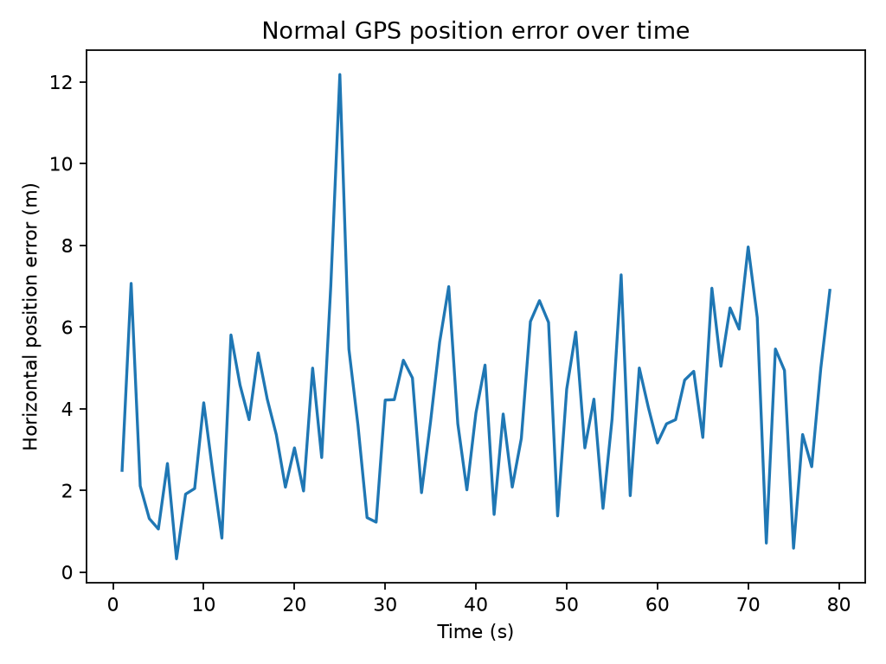
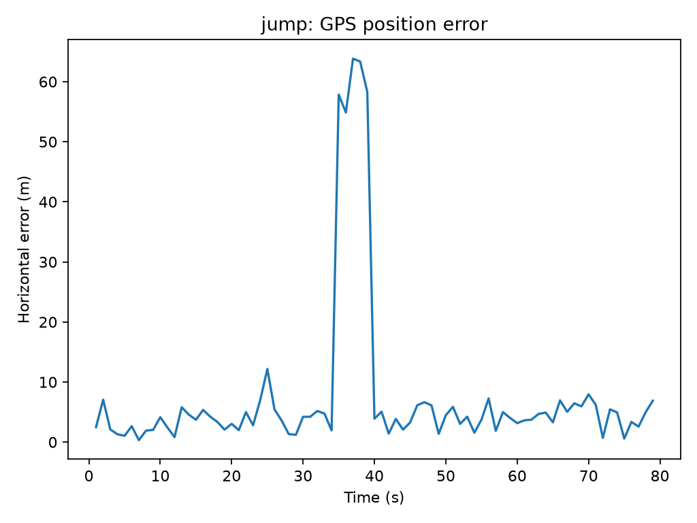
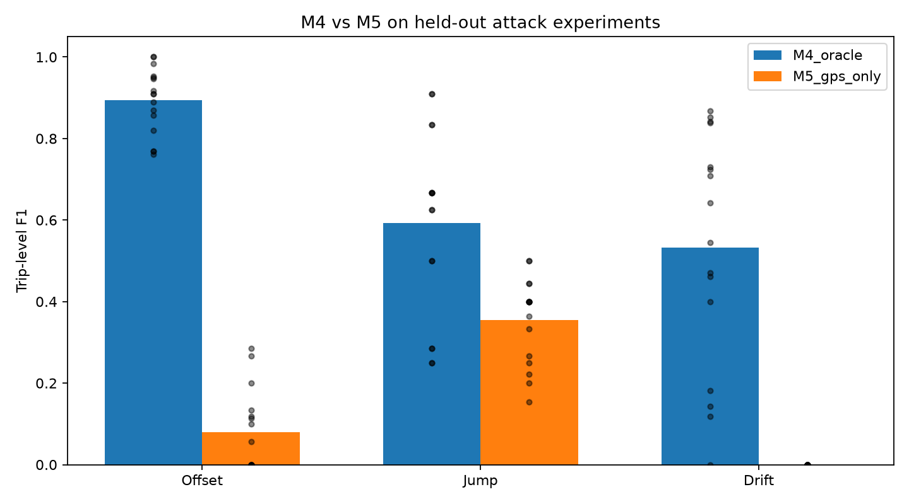
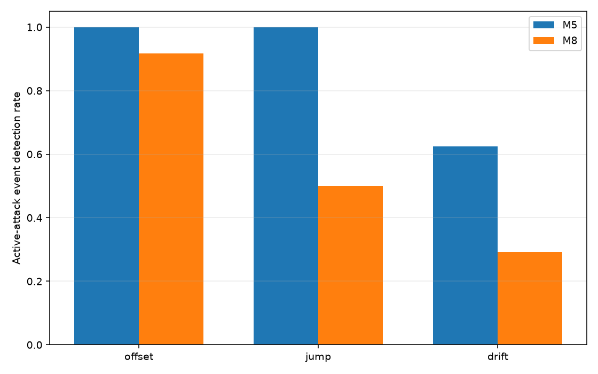
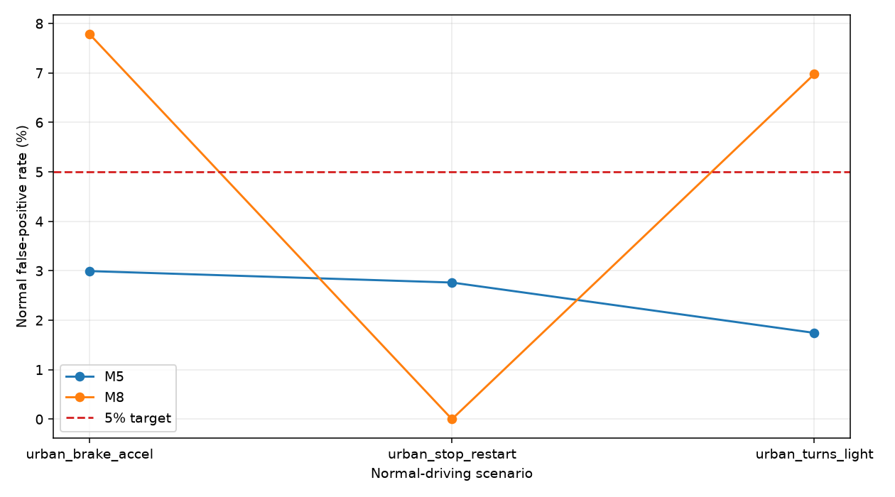
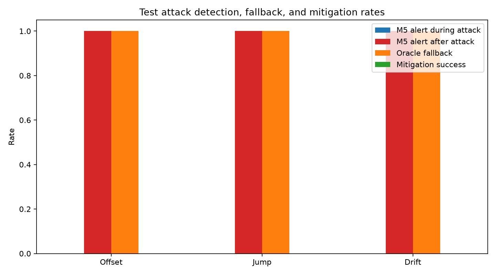
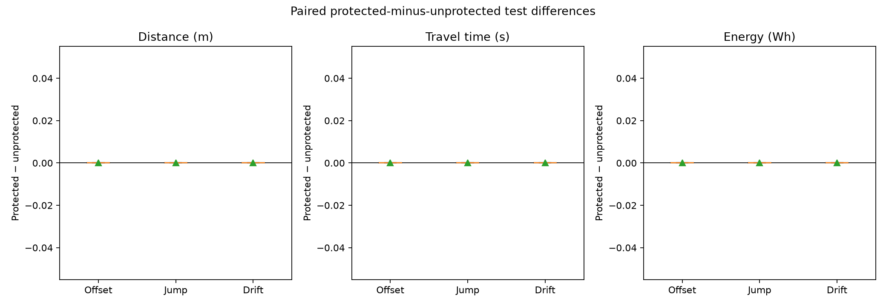

# Energy-Aware GPS Spoofing Detection for Electric Vehicle Eco-Routing Using Multi-Sensor Fusion

**Research Project Report**
Submitted to the **College of Sciences and Engineering of Southern University and A&M College**

[Candidate name]
[Degree and program]
[Submission date]

> **Title-scope disclosure:** This title is transcribed from the supplied template. M9 combines outputs from two GPS-only detectors; the completed project did not implement physical multi-sensor fusion across GPS, IMU, vehicle sensors, or map matching. Confirm with the department whether to retain or revise the template wording.

---

## Approval Page

**Candidate:** [Candidate name]
**Degree/program:** [To be confirmed]

| Approval role | Name and title | Signature | Date |
|---|---|---|---|
| Advisor / principal investigator | [To be confirmed] | [Signature placeholder] | [Date] |
| Faculty mentor | [To be confirmed] | [Signature placeholder] | [Date] |
| Department representative, if required | [To be confirmed] | [Signature placeholder] | [Date] |

No approval, signature, or date is asserted in this draft.

## Abstract

This study developed a simulation-only workflow for examining GPS manipulation detection and energy-aware routing in electric-vehicle (EV) trips. Across milestones M0-M9, a SUMO/TraCI environment produced separate simulator truth, noisy GPS observations, attack labels, detector predictions, and route/battery outcomes. The detector sequence included an oracle-assisted GPS-to-truth residual reference (M4), a causal GPS-only motion baseline (M5), an enhanced persistent GPS-only detector (M8), and hybrid output analysis (M9). M6 evaluated robustness across held-out seeds and two routes; M7 tested GPS-responsive rerouting and a SUMO-state fallback.

Results are mixed and bounded by small synthetic test matrices. The oracle-assisted M4 detector outperformed GPS-only M5 in the M6 macro-F1 results, but it requires simulator truth and is not a deployable GPS-only method. M8 did not improve active-event detection over M5 in its final held-out matrix and exceeded the 5% false-positive target in two motion profiles. M9 exposed trade-offs: OR increased event coverage while raising false positives; AND lowered false positives while missing more events; the staged fast-suspect result matched M5. M7 produced zero successful mitigations and zero protected-versus-unprotected paired improvements in the measured outcomes. GPS motion anomalies in these experiments do not establish spoofing attribution. The checkpoint also omits three local-only M1/M2 inputs, so it is not fully self-contained for reproduction.

**Word count (whitespace-delimited):** 205
**Keywords:** GPS spoofing; GNSS; electric vehicles; anomaly detection; SUMO; energy-aware routing; sensor security.

## Acknowledgements

[Add acknowledgements only after confirming people and contributions.]
[Add funding acknowledgement only if a funding source is confirmed.]

## Table of Contents

- [Approval Page](#approval-page)
- [Abstract](#abstract)
- [Acknowledgements](#acknowledgements)
- [List of Figures](#list-of-figures)
- [List of Abbreviations](#list-of-abbreviations)
- [Chapter 1 - Introduction](#chapter-1---introduction)
  - Sections 1.1-1.8: background, problem, significance, objectives, questions/hypotheses, scope, contributions, and report organization
- [Chapter 2 - Literature Review](#chapter-2---literature-review)
- [Chapter 3 - Methodology](#chapter-3---methodology)
  - Simulation, data boundaries, attack scenarios, M4/M5/M8/M9 methods, evaluation design
- [Chapter 4 - Results and Discussion](#chapter-4---results-and-discussion)
  - Baseline/M4/M5; M6 robustness; M8 comparison; M9 trade-offs; M7 routing/mitigation
- [Chapter 5 - Conclusion and Future Work](#chapter-5---conclusion-and-future-work)
  - Contributions, research-question answers, limitations, future work
- [References](#references)
- [Appendices](#appendices)

## List of Figures

1. M1 baseline battery charge and state of charge over time.
2. M2 horizontal GPS observation error over time.
3. M3 GPS position error during the finite-jump observation scenario.
4. M6 held-out trip-level F1 comparison for oracle-assisted M4 and GPS-only M5.
5. M8 held-out active-event detection rates for M5 and M8.
6. M8 profile-specific normal false-positive rates for M5 and M8.
7. M7 active detection, fallback, and mitigation rates by attack type.
8. M7 protected-minus-unprotected paired differences in distance, travel time, and energy.

## List of Abbreviations

| Abbreviation | Meaning |
|---|---|
| EV | Electric vehicle |
| FN | False negative |
| FPR | False-positive rate |
| FP | False positive |
| GNSS | Global Navigation Satellite System |
| GPS | Global Positioning System |
| IMU | Inertial measurement unit |
| M0-M9 | Completed project milestones 0 through 9 |
| SOC | State of charge |
| SUMO | Simulation of Urban MObility |
| TraCI | Traffic Control Interface |
| TN | True negative |
| TP | True positive |

# Chapter 1 - Introduction

## 1.1 Background and Context

EV routing depends on route choice and uncertain energy consumption, motivating eco-routing and stochastic energy-aware routing research [1], [2]. Autonomous-vehicle security research describes adversarial risks to navigation and perception sensors [3], [4]. GPS spoofing surveys, secure position estimation, location-spoofing detection, and crowd-sourced corroboration address related threat and defense questions [5]-[8]. This study tests selected simulated GPS anomalies, GPS-only motion detection, and whether GPS-responsive routing changes executed paths or measured energy outcomes.

The template title includes "Multi-Sensor Fusion." M9 combined outputs from two GPS-only detectors; it did not combine independent physical sensors. This title/method mismatch is flagged for institutional review.

## 1.2 Problem Statement

A GPS coordinate anomaly alone does not establish that a route changed, that the changed route was executed, or that energy use changed. Detection, attack attribution, route response, and mitigation are separate steps. A detector using simulator ground truth is not GPS-only, and a motion anomaly is not proof of spoofing.

## 1.3 Significance of the Study

The project makes data boundaries explicit and retains negative findings. M7 found no successful mitigation or paired improvement. M8 and M9 expose operating trade-offs rather than a uniformly better detector. These results constrain claims that can responsibly be made from simulation.

## 1.4 Research Objectives

1. Establish a repeatable SUMO/TraCI EV simulation and telemetry workflow.
2. Generate seeded normal GPS observations and offset, jump, and drift scenarios while keeping a physical route-deviation trip distinct.
3. Evaluate oracle-assisted M4, GPS-only M5 and M8, and M9 detector-output combinations.
4. Assess robustness across specified held-out seeds, routes, and profiles.
5. Test GPS-responsive routing and measure actual path, arrival, energy, regeneration, and SOC outcomes in paired conditions.

## 1.5 Research Questions and Hypotheses

**RQ1.** How did oracle-assisted M4 compare with GPS-only M5 in the initial and M6 test matrices?
**RQ2.** Did M8 improve active-event detection over M5 while controlling normal false positives?
**RQ3.** Did M7 fallback mitigate tested scenarios or improve paired route and energy outcomes?
**RQ4.** What false-positive and event-coverage trade-offs resulted from M9 OR, AND, and staged policies?

These propositions organize retrospective analysis; they were not preregistered and were not tested inferentially:

- **H1:** M8 would improve event detection over M5 without exceeding the 5% normal FPR target. Not supported by the final matrix.
- **H2:** M7 fallback would change paired route or energy outcomes. Not supported by the final paired matrix.
- **H3:** M9 fusion policies would trade event coverage against FPR. Consistent with the descriptive results.

## 1.6 Scope and Delimitations

This study covers completed M0-M9 work in simulation. It uses SUMO road-network coordinates in meters, simplified Gaussian GPS noise, synthetic attacks, and small trip/seed/route/profile matrices. No physical transmitter, real vehicle, receiver-level GNSS model, production detector, or deployment condition was evaluated. M4 uses simulator truth; M7 fallback reads SUMO route state. M5 and M8 are GPS-only motion anomaly methods. M9 combines detector outputs, not independent sensors.

Three M1/M2 input files remain local-only and are absent from the pushed checkpoint, so it is not self-contained for reproducing those runs. Unique M3 verification evidence remains in the older root project.

## 1.7 Research Contributions

- A SUMO/TraCI telemetry workflow with recorded configuration and seeds and separated truth/observation data.
- Separate normal GPS and attack artifacts with offline label sidecars.
- A comparison of an oracle-assisted residual reference with causal GPS-only temporal detectors.
- Held-out seed, route, profile, event-level, and paired evaluations retaining mixed and negative results.
- A GPS-responsive routing experiment recording actual route choices, executed paths, and battery outcomes.
- Quantified M9 OR, AND, and staged-output trade-offs.

## 1.8 Organization of the Report

Chapter 2 reviews literature and the research gap. Chapter 3 describes simulation, data boundaries, attacks, detectors, and evaluation. Chapter 4 presents M0-M9 findings and discussion. Chapter 5 answers the research questions and outlines future work. Appendices map claims to evidence and describe reproducibility limits.

# Chapter 2 - Literature Review

EV eco-routing studies motivate energy-aware route choice and account for uncertainty in energy consumption [1], [2]. Autonomous-vehicle security surveys frame the broader adversarial setting and the security of navigation and perception sensors [3], [4]. GPS-focused literature addresses spoofing threats, secure position estimation and sensor fusion, location-spoofing detection, and crowd-sourced corroboration [5]-[8].

The supplied references [9]-[12] are retained as supplementary literature, not as evidence for GPS detector performance or energy mitigation. Reference [9] concerns class-imbalanced vehicular-network intrusion detection; [10] concerns spoofed messages and trust in connected-vehicle communications; [11] applies SUMO in an urban transport social-acceptance assessment; and [12] concerns UAV detection, security, and communications. Their topics do not establish the project's GPS-position or EV-routing findings.

Threat and countermeasure work [13], [14] and vehicle-trajectory-based anomaly detection [15] provide additional background on spoofing and motion context.

# Chapter 3 - Methodology

## 3.1 Simulation foundation and data boundaries

The project used Python, SUMO, and TraCI. The seed-42 baseline used SUMO 1.28.0, one EV (`ev_001`), a one-lane, one-edge `road_0` network of length 1,000 m, a 1 s simulation step, and a configured battery capacity of 50,000 Wh with 25,000 Wh initial charge. The baseline completed 80 simulation steps and yielded 79 queryable telemetry samples at seconds 1 to 79. SUMO had removed the vehicle before arrival-step telemetry could be queried; no arrival row or state was synthesized. Battery state of charge (SOC) was derived as charge divided by capacity. The SUMO Electric documentation describes battery-device outputs, and the SUMO paper describes the microscopic simulator [16], [17]. The recorded verification was headless; this report does not claim SUMO-GUI visual verification.

The workflow kept distinct: (1) SUMO truth telemetry; (2) GPS observations; (3) attack labels and provenance sidecars used for offline scoring; (4) detector predictions and metrics; and (5) actual SUMO route, distance, battery, and SOC outcomes. M4 was an explicit oracle-assisted exception because it compared GPS coordinates with simulator truth. M5 and M8 used GPS-only features; M9 combined their prediction outputs. M7 fallback queried SUMO route/edge state and was therefore also oracle-assisted.

Normal GPS was generated using independent, zero-mean Gaussian noise with 3 m standard deviation per coordinate axis and recorded random seeds. This is a simplified stationary metric-coordinate approximation, not a receiver-level GNSS, multipath, or temporally correlated error model.

## 3.2 Milestone development and evidence provenance

| Milestone | Development and evidence-backed result | Canonical evidence |
|---|---|---|
| M0 | Established the SUMO/TraCI simulation foundation and fixed-seed configuration; baseline EV completed 80 steps on the 1,000 m one-edge road. | `TASKS.md` M0 work log; `README.md`; `config/experiment_config.yaml`; `sumo/network/m0.net.xml`. |
| M1 | Added truth telemetry and battery outputs; 79 active/queryable samples, initial charge 25,000 Wh, capacity 50,000 Wh, with no queryable arrival-step state. | `TASKS.md` M1 verification; local-only `data/raw/truth_ev_001_20261104T073118.622118Z.csv`, matching config and metadata files; `tests/test_m1_telemetry.py`. |
| M2 | Created separate seeded normal GPS observations. Across 79 matched fixes: mean error/MAE 3.995736 m, RMSE 4.504651 m, p95 6.999907 m, and zero unmatched records. | `docs/M2_NORMAL_GPS.md`; `reports/m2/gps_normal_ev_001_20261104T073118.622118Z_metrics.json`; local-only processed GPS input listed in the reproducibility disclosure. |
| M3 | Added offset, finite-jump, and capped gradual-drift GPS observations with separate labels; also evaluated a physical alternative-route trip. That route trip was separate and was not caused by GPS manipulation. | `docs/M3_GPS_ATTACKS.md`; provenance-preserving root evidence `external_historical_root_project/reports/m3/m3_final_verification/` and `external_historical_root_project/data/attacks/m3_final_verification/`. |
| M4 | Evaluated an oracle-assisted GPS-to-truth residual detector. It used the normal-only threshold and one-trip chronological evaluation described in Section 3.5. | `docs/M4_GPS_DETECTION.md`; `reports/m4/m4_final_02/{summary.csv,normal_metrics.json,offset_metrics.json,jump_metrics.json,drift_metrics.json}`. |
| M5 | Evaluated a causal GPS-only temporal baseline using current and previous observations. It was weak on offset and drift in its initial single-trip result. | `docs/M5_GPS_ONLY_DETECTION.md`; `reports/m5/m5_final_02/{summary.csv,normal_metrics.json,offset_metrics.json,jump_metrics.json,drift_metrics.json}`. |
| M6 | Evaluated M4 and M5 across held-out seeds and two route definitions. Both routes also appeared in calibration, so this did not constitute leave-one-route-out generalization. | `docs/M6_ROBUSTNESS_EVALUATION.md`; `reports/m6/m6_full_02/` and repeat `reports/m6/m6_full_03/`, including summaries and per-trip aggregates. |
| M7 | Implemented GPS-responsive routing and a SUMO-state fallback; the paired final matrix found no successful mitigation or paired outcome improvement. | `docs/M7_GPS_AWARE_ENERGY_ROUTING.md`; complete runs `reports/m7/full_matrix/m7_full_02/` and `reports/m7/full_matrix/m7_full_03/`, including paired CSVs and figures. |
| M8 | Added temporal features and persistence to a GPS-only detector; final held-out results were mixed/negative relative to M5. | `docs/M8_IMPROVED_GPS_DETECTION.md`; `reports/m8/stage2a/`; canonical final `reports/m8/stage2b/m8_stage2b_final_02/`. |
| M9 | Evaluated paired M5/M8 outputs using OR, AND, and staged combinations; quantified the resulting false-alarm and event-coverage trade-offs. | `docs/M9_DETECTOR_ERROR_ANALYSIS.md`; corrected canonical final runs `reports/m9/m9_stage2_final_03/` and `reports/m9/m9_stage2_final_04/`. |

The nested project is authoritative for M0-M9 implementation and canonical later-milestone reports. The root-only M3 final-verification artifacts are cited above by their original provenance and are not represented as nested-repository files. Exact report paths and limitations are cataloged in the [final evidence inventory](../reports/final_project/final_evidence_inventory.md).

## 3.3 GPS spoofing attack models

M3 generated three GPS-observation manipulation patterns: a position offset, a finite sudden jump, and a capped gradual drift. Truth telemetry and attack labels were kept in separate artifacts for offline evaluation. A fourth M3 scenario changed the physical SUMO route on a connected alternative route; it was a separate route-deviation experiment, not an effect caused by spoofed GPS input. M4-M9 detector evaluations focused on the stated GPS attack scenarios and do not establish detection of all real-world spoofing techniques.

## 3.4 Detection methods (M4, M5, M8, M9)

### M4: oracle-assisted residual reference

M4 calculated Euclidean distance between observed GPS and simulator-truth coordinates and flagged residuals above a normal-calibrated threshold. The threshold was the 95th percentile, 6.999907 m, calibrated on the first 39 of 79 normal samples. The held-out normal suffix contained 40 samples; false-positive rate (FPR) was 2/40 = 5%. Each attack scenario had 79 records. F1 was 0.9524 for offset, 0.7143 for jump, and 0.9000 for drift. Confusion counts (TP/FP/TN/FN) were offset 30/3/46/0, jump 5/4/70/0, and drift 27/3/46/3. This is an oracle-assisted offline benchmark, not a GPS-only or deployable detector.

### M5: GPS-only temporal baseline

M5 used causal current/previous GPS fixes to calculate estimated speed, speed change, and heading change, then applied frozen upper-quantile thresholds with an OR rule. The first fix was ineligible. On the initial one-trip test, normal suffix FPR was 2/40 = 5%. There were 78 eligible attack observations per scenario. F1/recall were offset 0.308/0.200 (6 TP, 24 FN), jump 0.571/0.800 (4 TP, 1 FN), and drift 0.216/0.133 (4 TP, 26 FN). These are single-trip/single-intensity demonstration results; the detector reports motion anomalies, not confirmed spoofing.

### M8: persistent GPS-only detector

M8 added causal acceleration and rolling speed-consistency features with persistence and clearing logic. Thresholds were calibrated on normal trips; validation selected operating persistence. M5 remained unchanged for comparison. In Stage 1, selected validation FPR was 8.74%, above the 5% target. Stage 2A selected a 2-of-5 rule with 4.23% validation FPR. In final Stage 2B, M5/M8 pooled normal FPR was 2.50%/4.81% over 520 normal fixes. Active-event results (M5/M8; 24 events per attack class for each detector) were offset 24/24 vs. 22/24, jump 24/24 vs. 12/24, and drift 15/24 vs. 7/24. M8's profile-specific normal FPR was 6.98% for turns/light, 0% for stop/restart, and 7.78% for brake/acceleration. Thus its pooled FPR was below 5%, while two profiles exceeded the target, and active-event detection was lower than M5 in all three attack classes.

### M9: hybrid output analysis

M9 combined paired M5/M8 predictions using OR, AND, and staged outputs. OR alerts when either detector alerts; AND requires both; staged emits M5 fast-suspect immediately and records M8 corroboration separately. It does not delay or suppress the M5 alert. A corroborated anomaly remains an anomaly signal, not proof of spoofing.

## 3.5 Experimental design and evaluation metrics

Early M4/M5 evaluations used a chronological calibration prefix and held-out suffix from one trip; they are not held-out-trip generalization estimates. M6 used normal-only calibration and final-test seeds across two route definitions, but both routes were represented during calibration. M8 separated calibration, validation, and reserved final-test data; M9 kept its six-trip validation split separate from its six-trip final test. M8 and M9 event recall counts detections during active attack intervals; post-attack alerts are reported separately. Observation-level metrics use eligible fixes and their stated denominators.

The project reports sample-level confusion counts and FPR where applicable, F1 and recall, held-out macro-F1 means and standard deviations, active-event detection counts/rates, detection delay, and post-attack alerts. M7 reports paired protected-minus-unprotected changes in arrival, route distance, travel time, energy consumption, regeneration, and SOC. The reporting keeps point-level and event-level performance separate, consistent with time-series evaluation concerns [18], [19]. Results from different milestones are not pooled because their attack grids, trip matrices, exclusions, and denominators differ.

# Chapter 4 - Results and Discussion

**Figure 1.** Battery charge and state of charge over the 79 queryable one-second samples of the seed-42 EV baseline. Initial battery charge was 25,000 Wh against a 50,000 Wh capacity; the arrival-step state was unavailable. This plot illustrates battery charge and SOC, not cumulative energy consumption or regeneration.

**Figure 2.** Horizontal GPS observation error across 79 active samples in the seed-2026 normal GPS baseline trip. This represents one simulated trip.

**Figure 3.** Position error during a simulated finite-jump GPS observation attack. This is an illustrative demonstration run, not the canonical final quantitative experiment; the manipulated GPS observation did not physically redirect the vehicle.

## 4.1 Baseline and initial detector results (M0-M5)

M0 established the SUMO/TraCI environment; the seed-42 EV completed 80 steps on a 1,000 m one-edge route. M1 recorded 79 queryable active samples, 25,000 Wh initial charge, and a 50,000 Wh battery capacity; arrival-step state was unavailable. M2 matched 79 normal GPS observations to truth, with mean error/MAE 3.995736 m, RMSE 4.504651 m, p95 6.999907 m, and zero unmatched records. M3 added offset, finite-jump, and capped gradual-drift observation scenarios plus a separate physical route-deviation trip; the latter was not caused by spoofed GPS.

| Initial evaluation | Method | Normal FPR | Attack results | Scope |
|---|---|---:|---|---|
| M4 | Oracle-assisted GPS-to-truth residual | 2/40 = 5% | F1: offset 0.9524, jump 0.7143, drift 0.9000; each attack scenario had 79 records. | One trip; uses truth. |
| M5 | GPS-only temporal thresholds | 2/40 = 5% | 78 eligible fixes/scenario; F1/recall: offset 0.308/0.200, jump 0.571/0.800, drift 0.216/0.133. | One trip and one intensity; first fix excluded. |

The M4 and M5 normal FPRs are both 5% on the initial suffix, but their attack results are not directly interchangeable because the methods and attack metrics differ. M4 is an oracle-assisted reference, not GPS-only capability.

## 4.2 M6 robustness evaluation

The M6 matrix contained 52 held-out configurations and 104 detector evaluations, with 16 scenario trips per attack group. Macro F1 (mean +/- standard deviation) for M4/M5 was offset 0.894 +/- 0.080 / 0.080 +/- 0.100, jump 0.592 +/- 0.228 / 0.355 +/- 0.106, and drift 0.533 +/- 0.292 / 0.000 +/- 0.000. Mean normal FPR across four final-test normal trips was 0.032 +/- 0.017 for M4 and 0.019 +/- 0.020 for M5. The M4 values retain its oracle-assisted status. Only two final-test seeds and two routes were used, the routes also occurred in calibration, and the tests used one EV without traffic; broad route or population generalization is not supported.

**Figure 4.** Held-out trip-level F1 by attack type for the oracle-assisted M4 residual detector and GPS-only M5 temporal detector. The evaluation matrix is small; M4 uses simulator ground truth and is not a GPS-only capability.

## 4.3 M8 held-out comparison

M8's pooled false-positive rate does not tell the full profile story: the final M8 rate exceeded 5% for brake/acceleration and turns/light, but not stop/restart. Across offset, jump, and drift, M8's active-event counts were lower than M5's. These are held-out results from the specified two-seed matrix, not a universal claim about temporal persistence or spoofing detection.

**Figure 5.** Held-out active-event detection rates for M5 and M8 across offset, jump, and drift scenarios. Canonical event counts (M5 vs. M8) were offset 24/24 vs. 22/24, jump 24/24 vs. 12/24, and drift 15/24 vs. 7/24; each detector had 24 events per attack class.

**Figure 6.** Profile-specific normal false-positive rates for M5 and M8 on the held-out evaluation matrix; the dashed line indicates the 5% target. Eligible-fix denominators were 167, 181, and 172 for brake/acceleration, stop/restart, and turns/light respectively (520 total). M8 exceeded the target in brake/acceleration and turns/light despite its pooled rate being below 5%.

## 4.4 M9 hybrid trade-offs

On 537 eligible normal fixes, final M9 normal FPR was 2.98% for M5, 7.26% for M8, 9.12% for OR, 1.12% for AND, 2.98% for staged fast-suspect, and 5.77% for staged corroborated. In the same order, active-event counts were 58/72, 60/72, 66/72, 50/72, 58/72, and 52/72. OR increased event coverage relative to M5 but had the highest false-positive rate. AND reduced false positives while reducing event detection. Staged fast-suspect matched M5 exactly; the corroboration state is a separate signal and not attack confirmation. These six-trip results are descriptive.

### M9 per-profile normal false-positive rates

| Profile | M5 | M8 | OR | AND | Staged fast suspect | Staged corroborated |
|---|---:|---:|---:|---:|---:|---:|
| Turns/light | 3.54% | 9.60% | 11.62% | 1.52% | 3.54% | 8.59% |
| Stop/restart | 3.49% | 9.88% | 12.21% | 1.16% | 3.49% | 5.23% |
| Brake/accel | 1.80% | 1.80% | 2.99% | 0.60% | 1.80% | 2.99% |

Pooled eligible-fix denominators were 198 turns/light, 172 stop/restart, and 167 brake/acceleration (537 total). M8, OR, and staged corroborated exceeded 5% pooled FPR; OR was highest. The staged-fast candidate was selected on validation data under the 5% pooled validation limit; final-test data were not used to tune it.

### M9 jump-duration comparison

| System | 1-second jump events | Mean delay | 5-second jump events | Mean delay |
|---|---:|---:|---:|---:|
| M5 | 12/12 | 0 s | 12/12 | 0 s |
| M8 | 8/12 | 0 s | 12/12 | 0.33 s |
| OR | 12/12 | 0 s | 12/12 | 0 s |
| AND | 8/12 | 0 s | 12/12 | 0.33 s |
| Staged fast suspect | 12/12 | 0 s | 12/12 | 0 s |
| Staged corroborated | 8/12 | 0 s | 12/12 | 0.33 s |

Each duration contains 12 events across two jump magnitudes, three profiles, and two seeds per profile. This six-trip matrix is descriptive. In M8 Stage 2B specifically, M8 missed all one-second jumps (0/6 per magnitude) while M5 detected all six; the M9 combined result has a denominator of 12 across both magnitudes and all three profiles.

## 4.5 Energy-aware routing and mitigation findings (M7)

M7 implemented GPS-responsive route selection while the EV remained on a shared approach edge and logged actual SUMO route changes and executed edges. In some 180 m offset runs, the vehicle took the alternative path (2/8 per spoofed condition). The protected condition retained M5 thresholds and invoked SUMO's route finder after an alert. Because fallback reads SUMO route/edge state, it is oracle-assisted.

In the Stage 1 smoke pair, an unprotected offset trip used 1,449.65 m and 224.53 Wh, compared with 1,378.50 m and 162.06 Wh for the normal-GPS direct trip. This single pair does not establish a repeatable effect. In the final Stage 2 paired matrix, there were 48 attack runs (24 pairs) and two normal controls. Active M5 detection was 0/8 for offset, jump, and drift; every attack condition had 8/8 post-attack alerts and 8/8 fallback activations, but 0/8 successful mitigations. Across all 24 pairs, protected-minus-unprotected mean changes were zero for arrival, route distance, travel time, consumed energy, regeneration, and SOC. The fallback acted after attack recovery. The results support neither a mitigation benefit nor an energy-saving claim. Published EV energy models also treat consumption and regenerative braking as dependent on the modeled vehicle and operating conditions [20]; this experiment does not validate a physical EV model.

**Figure 7.** M7 detection and fallback outcomes across the paired test matrix. Each attack type recorded 0/8 active-attack detections and 0/8 successful mitigations, despite 8/8 post-attack alerts and fallback activations. Fallback activation is not successful mitigation.

**Figure 8.** Protected-minus-unprotected mean paired differences in distance, travel time, and energy consumption were zero across the tested M7 attack pairs. The plot does not show SOC or regenerated energy.

# Chapter 5 - Conclusion and Future Work

## 5.1 Research contributions and integrated interpretation

The project's contributions are an auditable SUMO/TraCI telemetry pipeline with explicit data boundaries; separate normal GPS and attack artifacts; a direct comparison between an oracle-assisted residual reference and GPS-only temporal detectors; held-out, event-level, and multi-profile evaluations; and a GPS-responsive routing test that measured executed paths and battery outcomes. M9 further made the trade-offs among OR, AND, and staged outputs measurable rather than presenting fusion as an unqualified improvement.

The central finding is methodological: detection, attribution, and mitigation are different tasks. M4's strong initial residual result depends on ground truth. M5 provides a transparent GPS-only baseline, but it performs poorly for offset and drift in its initial test and across the M6 matrix. M8's persistence changed the error profile without improving event detection over M5 in the final matrix. M9 changed coverage and false-alarm trade-offs but did not turn motion anomalies into proof of spoofing. M7 did not mitigate the tested attacks or improve paired energy outcomes.

## 5.2 Conclusions and answers to the research questions

**RQ1:** M4 outperformed M5 in the initial test and M6 macro-F1 results, but M4 requires simulator truth and is not GPS-only capability.
**RQ2:** M8 did not improve active-event detection over M5 in its final held-out matrix; two profiles exceeded 5% FPR.
**RQ3:** M7 produced zero successful mitigations and zero paired improvements in route and energy outcomes; its oracle-assisted fallback acted after recovery.
**RQ4:** OR increased event coverage and false positives; AND reduced false positives while missing more events; staged fast-suspect reproduced M5, and corroboration is not confirmation.

The project establishes a simulation/evaluation workflow and bounded findings, not a validated production detector or demonstrated energy-saving intervention.

## 5.3 Limitations and threats to validity

1. **Simulation realism:** SUMO networks, vehicle behavior, and traffic are simplified. Independent Gaussian coordinate noise is not a receiver-level, multipath, or temporally correlated GNSS model.
2. **Sample size and scope:** Many experiments use one EV and small synthetic networks. M6 has two final-test seeds and two routes; M8 and M9 final matrices each cover six trips. Results are descriptive and do not establish population effects.
3. **Route generalization:** Both M6 route definitions appear in calibration; M6 is not leave-one-route-out evaluation.
4. **Observability:** For the M5/M8 feature design, a constant translation leaves successive coordinate differences unchanged, while sufficiently slow drift can remain below motion thresholds. These are limitations of the tested GPS-only features, not universal claims about GNSS spoofing. Maneuvers can also cause motion anomalies. An anomaly is not confirmation of an attack.
5. **Unequal evaluation scopes:** M4/M5, M6, M8, and M9 use different trip matrices, attack severities, exclusions, and denominators. Their metrics must be interpreted within each experiment.
6. **Oracle conditions:** M4 uses simulator truth and M7 fallback reads SUMO route state; neither represents an operational GPS-only capability.
7. **Energy model:** Energy outcomes come from SUMO's configured vehicle/battery model. The experiments do not validate physical-EV consumption or establish real-world range or safety effects [20].
8. **GUI verification:** Historical records document headless checks. Interactive SUMO-GUI visual verification was not completed.
9. **Reproducibility inputs:** Three M1/M2 files remain local-only and are not included in the pushed GitHub checkpoint: `data/raw/truth_ev_001_20261104T073118.622118Z.csv`, `data/raw/truth_ev_001_20261104T073118.622118Z_metadata.yaml`, and `data/processed/gps_normal_ev_001_20261104T073118.622118Z.csv`. The checkpoint is not fully self-contained for reproducing those runs.
10. **Reference verification:** References [5], [9], and [10] are partially verified. Their bibliographic details were supported by secondary records or accessible manuscripts but were not independently confirmed against accessible publisher records. This disclosure does not imply they are fabricated or invalid.

## 5.4 Future Work

This M0-M9 project establishes a simulation and evaluation workflow, not a validated production detector. Its evidence favors keeping simulator truth, GPS observations, labels, predictions, and route/energy outcomes distinct; separating anomaly detection from attack attribution; and requiring actual route changes and executed-path measurements before making energy claims.

The evaluated M4 residual detector is an oracle-assisted reference. M5 is the GPS-only baseline with weak offset/drift results in the tested settings. M8's enhanced temporal features and persistence did not improve active-event detection over M5 in the final matrix. M9 quantified false-alarm and event-coverage trade-offs, while staged fast-suspect reproduced M5. M7 recorded zero successful mitigations and zero paired outcome improvements.

Future work should use more independently held-out roads, traffic, vehicle configurations, and trips; model temporally correlated receiver-level GNSS effects; test observable sensors and map/topology constraints without simulator truth; and improve the timeliness and observability of routing protection. Larger independent test matrices are needed before inferential or deployment claims. Future energy experiments should continue to report route choice, executed route, arrival, distance, consumption, regeneration, and SOC for matched pairs.

# References

Bibliographic verification note: References [5], [9], and [10] are partially verified. Their details were supported by secondary records or accessible manuscripts, but were not independently confirmed against accessible publisher records. This status does not imply that the references are fabricated or invalid.

[1] N. Salahi, J. Ryu, J. Y. Kim, G. Bang, K. Hyun, and J. Y. Park, “Data-driven eco-routing for optimizing energy efficient electric vehicle driving,” *Sustainable Cities and Society*, vol. 149, Art. no. 107812, 2026, doi: [10.1016/j.scs.2026.107812](https://doi.org/10.1016/j.scs.2026.107812).

[2] A. Spinelli, D. Bezzi, O. Jabali, and F. Maggioni, “A stochastic electric vehicle routing problem under uncertain energy consumption,” *Transportation Research Part C: Emerging Technologies*, vol. 183, Art. no. 105480, Feb. 2026, doi: [10.1016/j.trc.2025.105480](https://doi.org/10.1016/j.trc.2025.105480).

[3] A. N. Devanesan, S. Hanoun, B. Karthikeyan, and A. Z. Kouzani, “Adversarial attacks in autonomous vehicles: A comprehensive review of threats and defence strategies,” *IEEE Access*, vol. 14, pp. 135233–135253, 2026, doi: [10.1109/ACCESS.2026.3727983](https://doi.org/10.1109/ACCESS.2026.3727983).

[4] A. Solanki, W. Al Amiri, M. Mahmoud, B. Swieder, S. R. Hasan, and T. N. Guo, “Survey of navigational perception sensors’ security in autonomous vehicles,” *IEEE Access*, vol. 13, pp. 104937–104965, 2025, doi: [10.1109/ACCESS.2025.3578891](https://doi.org/10.1109/ACCESS.2025.3578891).

[5] S. Jeyaseelan, P. G. S. Velmurugan, and S. Rajaram, “A comprehensive survey of GPS spoofing attacks and detection mechanisms in autonomous vehicles,” in *Proc. 2025 IEEE 17th Int. Conf. Computational Intelligence and Communication Networks (CICN)*, Goa, India, Dec. 2025, pp. 702–707, doi: [10.1109/CICN67655.2025.11367991](https://doi.org/10.1109/CICN67655.2025.11367991).

[6] Q. Chen, G. Li, P. Liu, and Z. Wang, “Anomaly detection and secure position estimation against GPS spoofing attack: A security-critical study of localization in autonomous driving,” *IEEE Transactions on Vehicular Technology*, vol. 74, no. 1, pp. 87–99, Jan. 2025, doi: [10.1109/TVT.2024.3454416](https://doi.org/10.1109/TVT.2024.3454416).

[7] M. Arsalan, M. A. Ayaz, I. A. Khan, F. Ullah, M. Kamal, F. Khan, and K. Alshammari, “A novel GPS location spoofing attack detection mechanism for autonomous vehicles,” *Wireless Personal Communications*, vol. 146, no. 6, pp. 3695–3715, 2026, doi: [10.1007/s11277-026-12095-0](https://doi.org/10.1007/s11277-026-12095-0).

[8] G. Oligeri, S. Sciancalepore, O. A. Ibrahim, and R. Di Pietro, “GPS spoofing detection via crowd-sourced information for connected vehicles,” *Computer Networks*, vol. 216, Art. no. 109230, 2022, doi: [10.1016/j.comnet.2022.109230](https://doi.org/10.1016/j.comnet.2022.109230).

[9] P. Dubey and D. Agrawal, “Comparative analysis of hybrid machine learning and deep learning models for intrusion detection in vehicular networks under severe class imbalance,” in *Proc. 4th Int. Conf. Inventive Computing and Informatics (ICICI)*, Bangalore, India, 2026, pp. 760–767, doi: [10.1109/ICICI68773.2026.11581012](https://doi.org/10.1109/ICICI68773.2026.11581012).

[10] S. O. Ajakwe and D.-S. Kim, “EQAI: Explainable quantum-empowered antispoofing intelligence for trustworthy connected autonomous vehicles communication,” *IEEE Internet of Things Journal*, vol. 13, no. 6, pp. 10213–10232, 2026, doi: [10.1109/JIOT.2025.3638378](https://doi.org/10.1109/JIOT.2025.3638378).

[11] N. España, J. Murillo-Hoyos, and E. Caicedo, “Social acceptance assessment of alternative urban sustainable transport technologies in intermediate cities using AHP and SUMO,” *World Development Sustainability*, vol. 6, Art. no. 100229, 2025, doi: [10.1016/j.wds.2025.100229](https://doi.org/10.1016/j.wds.2025.100229).

[12] G. E. M. Abro, S. A. B. M. Zulkifli, R. J. Masood, V. S. Asirvadam, and A. Laouiti, “Comprehensive review of UAV detection, security, and communication advancements to prevent threats,” *Drones*, vol. 6, no. 10, Art. no. 284, 2022, doi: [10.3390/drones6100284](https://doi.org/10.3390/drones6100284).

[13] T. E. Humphreys, B. M. Ledvina, M. L. Psiaki, B. W. O’Hanlon, and P. M. Kintner, “Assessing the spoofing threat: Development of a portable GPS civilian spoofer,” in *Proc. 21st Int. Tech. Meeting Satellite Division of the Institute of Navigation (ION GNSS 2008)*, Savannah, GA, USA, Sep. 2008, pp. 2314–2325. [Online]. Available: https://www.ion.org/publications/abstract.cfm?articleID=8132.

[14] C. Günther, “A survey of spoofing and counter-measures,” *NAVIGATION*, vol. 61, no. 3, pp. 159–177, 2014, doi: [10.1002/navi.65](https://doi.org/10.1002/navi.65).

[15] Z. Yang, J. Ying, J. Shen, Y. Feng, Q. A. Chen, Z. M. Mao, and H. X. Liu, “Anomaly detection against GPS spoofing attacks on connected and autonomous vehicles using learning from demonstration,” *IEEE Transactions on Intelligent Transportation Systems*, vol. 24, no. 9, pp. 9462–9475, 2023, doi: [10.1109/TITS.2023.3269029](https://doi.org/10.1109/TITS.2023.3269029).

[16] German Aerospace Center (DLR), “Electric,” *Eclipse SUMO Documentation*. [Online]. Available: https://sumo.dlr.de/docs/Models/Electric.html. Accessed: Nov. 12, 2026.

[17] P. Alvarez Lopez, M. Behrisch, L. Bieker-Walz, J. Erdmann, Y.-P. Flötteröd, R. Hilbrich, L. Lücken, J. Rummel, P. Wagner, and E. Wießner, “Microscopic traffic simulation using SUMO,” in *Proc. 21st IEEE Int. Conf. Intelligent Transportation Systems (ITSC)*, 2018, pp. 2575–2582, doi: [10.1109/ITSC.2018.8569938](https://doi.org/10.1109/ITSC.2018.8569938).

[18] N. Tatbul, T. J. Lee, S. Zdonik, M. Alam, and J. Gottschlich, “Precision and recall for time series,” in *Advances in Neural Information Processing Systems*, vol. 31, 2018. [Online]. Available: https://papers.nips.cc/paper_files/paper/2018/hash/8f468c873a32bb0619eaeb2050ba45d1-Abstract.html.

[19] A. Garg, W. Zhang, J. Samaran, R. Savitha, and C.-S. Foo, “An evaluation of anomaly detection and diagnosis in multivariate time series,” *IEEE Transactions on Neural Networks and Learning Systems*, vol. 33, no. 6, pp. 2508–2517, 2022, doi: [10.1109/TNNLS.2021.3105827](https://doi.org/10.1109/TNNLS.2021.3105827).

[20] C. Fiori, K. Ahn, and H. A. Rakha, “Power-based electric vehicle energy consumption model: Model development and validation,” *Applied Energy*, vol. 168, pp. 257–268, 2016, doi: [10.1016/j.apenergy.2016.01.097](https://doi.org/10.1016/j.apenergy.2016.01.097).

# Appendices

## Appendix A - Evidence paths and provenance

The nested repository is authoritative for M0-M9 implementation, configurations, methods, and canonical later-milestone reports. The older root project is historical material. Unique M3 final-verification artifacts remain at their original root-project locations and are not represented as files inside the nested repository. The [final evidence inventory](../reports/final_project/final_evidence_inventory.md) maps milestones to evidence and limitations.

| Milestone | Evidence location |
|---|---|
| M0-M1 | `TASKS.md` verification; `config/experiment_config.yaml`; `sumo/network/m0.net.xml`; M1 telemetry (some inputs local-only). |
| M2 | `reports/m2/gps_normal_ev_001_20261104T073118.622118Z_metrics.json`. |
| M3 | Root-project `reports/m3/m3_final_verification/` and `data/attacks/m3_final_verification/`; inventory provenance prefix `external_historical_root_project/`. |
| M4 | `reports/m4/m4_final_02/`. |
| M5 | `reports/m5/m5_final_02/`. |
| M6 | `reports/m6/m6_full_02/` and `reports/m6/m6_full_03/`. |
| M7 | `reports/m7/full_matrix/m7_full_02/` and `reports/m7/full_matrix/m7_full_03/`. |
| M8 | `reports/m8/stage2b/m8_stage2b_final_02/`. |
| M9 | Corrected canonical `reports/m9/m9_stage2_final_03/` and `reports/m9/m9_stage2_final_04/`. |

## Appendix B - Reproducibility and configurations

Three M1/M2 inputs remain local-only and are not in the pushed GitHub checkpoint:

- `data/raw/truth_ev_001_20261104T073118.622118Z.csv`
- `data/raw/truth_ev_001_20261104T073118.622118Z_metadata.yaml`
- `data/processed/gps_normal_ev_001_20261104T073118.622118Z.csv`

The checkpoint is not fully self-contained for reproducing those runs. Relevant configurations include `config/experiment_config.yaml`, `config/m3_route_deviation.yaml`, `config/m6_robustness.yaml`, `config/m7_energy_routing.yaml`, `config/m8_stage2b.yaml`, and `config/m9_analysis.yaml`. No experiment was rerun for this report.

## Appendix C - Institutional items to confirm

- Candidate name, degree/program, submission date, advisor, faculty mentor, and approval roles/signatures.
- Whether to retain "Multi-Sensor Fusion" in the title given that M9 combines GPS-only detector outputs.
- Department pagination, margins, font, binding, and citation-placement requirements before final typesetting.
- Acknowledgement and funding statements only after confirming the information.
